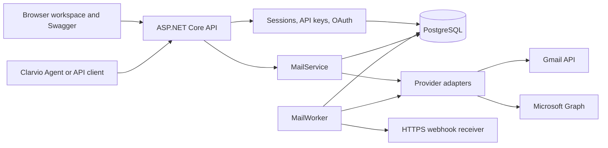

# Architecture

[Documentation index](README.md) · [API reference](api.md)

Clarvio Mail is one ASP.NET Core / .NET 10 application with a static browser workspace, HTTP API, OAuth callbacks, and background worker. PostgreSQL 18 stores service state. Gmail and Microsoft retain the actual mailboxes; this application does not host mail domains or run an SMTP server.

## Source layout

| Directory | Responsibility |
| --- | --- |
| `src/Clarvio.Mail/Api` | Routes, OpenAPI descriptions, bundled Swagger initialization |
| `src/Clarvio.Mail/Auth` | OAuth flow, session identity, API key scopes, CSRF |
| `src/Clarvio.Mail/Core` | Validated configuration, encryption, error helpers |
| `src/Clarvio.Mail/Data` | Entities, EF migrations, PostgreSQL coordination locks |
| `src/Clarvio.Mail/Providers` | Gmail/Graph adapters and shared message contracts |
| `src/Clarvio.Mail/Services` | Ownership checks, sends, polling, webhook delivery |
| `src/Clarvio.Mail/wwwroot` | Browser HTML, JavaScript, CSS, and assets |
| `scripts` | Local credential setup and service lifecycle |
| `tests` | Backend integration/security tests and browser tests |

## Identity and ownership

OAuth uses authorization codes with PKCE and a short-lived, one-use state bound to the initiating browser. Provider identities are associated by provider and subject; an email string does not automatically merge identities.

A signed-in user owns a workspace and its connected mailboxes, API keys, webhook subscriptions, activity, and send operations. Queries enforce that ownership. **Connect account** attaches a mailbox to the existing workspace. Signing in with a different provider identity is a separate flow and does not automatically join the original workspace.

Browser sessions use HttpOnly cookies. API keys are bearer credentials with explicit read/write/send scopes and expiration. Session mutations require CSRF validation. Management endpoints require a browser session even if a key has mailbox scopes.

## Credentials and persistence

Provider access/refresh tokens and webhook signing secrets are encrypted with AES-256-GCM using versioned encryption keys and purpose binding. Session and API key tokens are stored as hashes. The API returns new key/signing-secret values only on creation.

PostgreSQL stores users, provider identities, sessions, OAuth attempts, connected mailboxes, API keys, send operations, audit events, polling state, incoming events, subscriptions, and webhook deliveries. It is not a full mailbox archive. Message listing, body reads, drafts, and attachments are fetched from providers.

Database coordination locks serialize refresh/send/poll/delivery work where required. Send intents and incoming events have database uniqueness constraints for deduplication. API send idempotency records a result around provider submission; it does not guarantee final email delivery.

Keep database backups and encryption keys together in protected storage. Retain earlier key versions when rotating the active key. Losing a key can make stored provider credentials and webhook secrets unreadable.

## Provider adapters

`IEmailProvider` defines authorization, token refresh, account identity, message reads, attachments, sends, replies, change polling, folders, read state, moves, and draft operations. `ProviderRegistry` selects the Gmail or Outlook adapter. `MailService` handles ownership, token access, cursor binding, and operation persistence around those adapters.

| Provider | Current behavior |
| --- | --- |
| Gmail | HTTPS Gmail API; MIME built with MimeKit; labels instead of exclusive folders; draft IDs differ from message IDs |
| Microsoft | HTTPS Microsoft Graph; folder hierarchy and native message/draft operations; send acceptance may not include a message ID |
| Yahoo / generic providers | Not implemented; an IMAP/SMTP adapter and connection workflow are planned |

OAuth is an authorization mechanism, while IMAP and SMTP are mail protocols. Current providers use OAuth-authorized HTTP APIs. MimeKit constructs messages and attachments; its use does not mean that Clarvio Mail opens SMTP or IMAP connections.

An IMAP/SMTP adapter would implement the shared provider operations while preserving the HTTP API. It also needs provider-specific credentials, connection settings, mailbox semantics, and compatibility tests. See [provider support](../README.md#email-protocols-and-provider-support) for the current Yahoo plan.

## Background work and boundaries

`MailWorker` polls mailboxes with active webhook subscriptions, suppresses the initial synchronization, persists deduplicated events, and delivers signed requests with retries. It also cleans expired authentication state and marks stale send operations as unknown.

The current worker runs inside the application process. There is no separate job-service deployment or provider push-subscription integration. Webhook receiver processing must tolerate duplicate deliveries, and polling semantics still require live-provider validation before production use.

Provider calls and local persistence are separate systems. Interrupted sends can have unknown outcomes; multipart draft edits can be partially applied by a provider. Read the [API outcome guidance](api.md#send-outcomes-and-idempotency) before implementing retries.

Local development, Swagger, production Docker/Compose packaging, trusted proxy handling, release commands, and backup/restore are implemented. The actual Clarvio server deployment and Agent integration remain pending; see the [server deployment guide](deployment.md).

## Clarvio Agent adapter

`connector/` is a separate stateless Python MCP service in this Mail platform repository. It forwards only each request's scoped API key to a fixed Mail origin; it stores no account credentials or caches. Agent fetches its manifest and operations skill and applies existing approval rules using the tool annotations. File inputs use base64 fields and outputs use embedded blobs. An optional webhook bridge verifies Mail signatures, binds mailbox IDs to persistent operator-configured Agent connection IDs, and translates payloads/signatures without acknowledging delivery before Agent accepts it. See [the MCP guide](mcp.md) for the full contract, limits and deployment.
